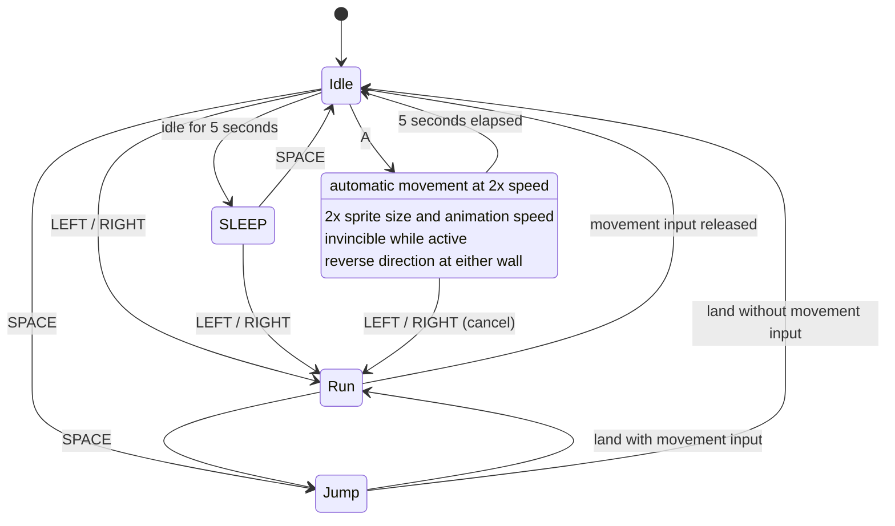

# Character controller state diagram

Wall reflection updates direction inside AutoRun; it does not re-enter the state,
so hitting a wall never resets the five-second deadline. Timeout and cancellation
both remove invincibility and restore the normal drawing size.
